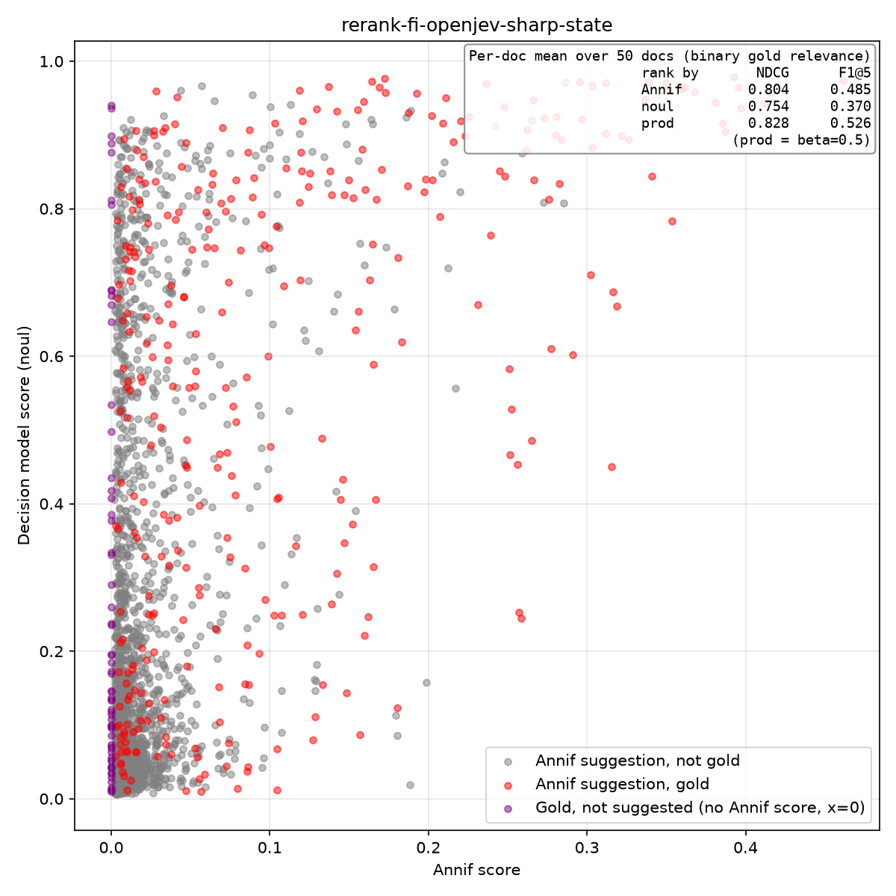

# Annif-decision-models — Jev-like reranking of Annif suggestions (prototype)

Prototype to test whether a Jev-like decision model (served by llama.cpp
via the `/v1/systemone` System One endpoint) can rerank Annif's automated
subject-indexing suggestions.

For each book it asks the model a yes/no (**noul**) question per candidate
subject — *"Is 'X' a central subject of this document…"* — using the
document text as the state, and records the returned probability per
subject to CSV for later analysis.

See [`plans/prototype.md`](plans/prototype.md) for the design and CSV
schema.

## Setup

```bash
python -m venv .venv
./.venv/bin/pip install -r requirements.txt   # requests, pandas, matplotlib
```

The test-set book blurbs (`jev-test-sets/{en,fi}/*.txt`) are
copyrighted and not included in the repository; only the Annif
suggestions (`.annif`) and gold label files (`.tsv`) are. Provide the
`.txt` files from the original source to run [`rerank.py`](rerank.py)
on a fresh clone.

## Usage

```bash
# Inspect the request payload for the first book (no API call):
./.venv/bin/python rerank.py --dry-run

# Run against the OpenJev model (CSV → stdout by default):
./.venv/bin/python rerank.py \
    --base-url http://localhost:8080 \
    --question-style sharp \
    --output results/rerank-en-openjev-sharp.csv

# Recommended configuration (OpenJev + state rules, best fi result):
./.venv/bin/python rerank.py \
    --base-url http://localhost:8080 \
    --state-rules \
    --output results/rerank-en-openjev-sharp-state.csv
```

`--base-url` and `--model` also read `ANNIF_JEV_URL` / `ANNIF_JEV_MODEL`
env vars. Defaults are `http://localhost:8080` and `ggml-org/lev-GGUF`.

For a full unattended run (all four configs: en/fi × with/without
`--state-rules`, plus blend sweeps, plots and a summary), use
[`run_model.sh`](run_model.sh):

```bash
nohup ./run_model.sh openjev > /dev/null 2>&1 &   # model name as $1
tail -f logs/openjev/run-*.log
```

### Key options

| option | purpose |
|--------|---------|
| `--dataset-dir` | dir with `.txt`/`.annif`/`.tsv` (default `jev-test-sets/en`) |
| `--lang` | language tag (default `en`) |
| `--base-url` / `--model` | decision-model server + model id |
| `--question-style` | `plain` (topically about) or `sharp` (central subject, rejects passing mentions; clearly better) |
| `--state-rules` | toggle for the built-in indexing-rules state prefix (the format/genre rule; strongest effect for OpenJev and Bespoke-Nimble, see Findings) |
| `--state-prefix` | custom text prepended to the document state for every question; overrides `--state-rules` |
| `--limit` | max Annif suggestions per doc (default 50) |
| `--max-docs` | process only the first N docs (0 = all) |
| `--dry-run` | print first payload and exit, no API call |
| `--output` | CSV path, or `-` for stdout (default `-`) |

## Output

One row per (book, subject), written as CSV to **stdout** by default
(progress goes to **stderr**). Pass `--output <file>` to write to a file.
Each row includes Annif's original score/rank, the model's `noul_score`,
whether the subject is in the gold set (`in_gold`), and `source`
(`annif` vs `gold_extra` — gold subjects the base list did not contain,
added so analysis can measure the model's ability to find
correct-but-unsuggested subjects).

## Phase 2: analysis

[`analyze.py`](analyze.py) reads a rerank CSV and produces a scatterplot
(Annif score vs. decision-model noul score), with per-document NDCG (full
list) and F1@5 for the Annif, noul, and best product blend shown on the
plot. Gold subjects are red, non-gold are grey, and gold-extra
(correct-but-unsuggested) are purple at x=0. The output PNG is named after
the input CSV.

```bash
./.venv/bin/python analyze.py results/rerank-en-lev-sharp-state.csv
```

[`blend.py`](blend.py) tests ways of merging the two scores to rank each
document's Annif-suggested candidates, sweeping a hyperparameter per
strategy and reporting mean NDCG (full list) and F1@5 against the Annif
and noul baselines:

| strategy | idea | swept param |
|----------|------|-------------|
| `gate`   | keep noul ≥ gate, then rank survivors by Annif | gate |
| `geom`   | `norm(annif)^a · norm(noul)^(1-a)` | a |
| `linear` | `α·norm(annif) + (1-α)·norm(noul)` (clm.py baseline) | α |
| `prod`   | `norm(annif) · noul^β` | β |
| `rrf`    | `1/(k+rank_annif) + 1/(k+rank_noul)` | k |
| `odds`   | the dm_rerank backend formula: `norm(annif) · ((noul+ε)/(1−noul+ε))^b · σ((noul−τ)/0.1)`, then squashed by `x/(1+x)` (τ=−1, gate off). Unlike `prod`, the odds factor can exceed 1, so b > 1 can *boost* candidates above their source score | b |

```bash
./.venv/bin/python blend.py results/rerank-en-lev-sharp-state.csv results/rerank-fi-lev-sharp.csv
```

The best hyperparameter per strategy is marked with `*`.

## Findings (en 63 docs / fi 50 docs)

Decision models were run with the `sharp` predicate, with and
without the built-in state-prefix rules (`--state-rules`). Raw scores are
the model's noul alone; "best blend" is the top merge from
[`blend.py`](blend.py) — the **`odds`** (dm_rerank backend) formula for
most en models, `geom` for the best fi results, and `gate` still
delivers Kev's best F1@5 thanks to its sharply bimodal scores.

**Raw model scores (NDCG / F1@5):**

| model | en sharp | en sharp+rules | fi sharp | fi sharp+rules |
|---|---|---|---|---|
| Annif (baseline, no model) | 0.796 / 0.502 | 0.796 / 0.502 | 0.804 / 0.485 | 0.804 / 0.485 |
| Laya (421M BF16) | 0.533 / 0.193 | 0.539 / 0.172 | 0.511 / 0.169 | 0.465 / 0.133 |
| d1-omni-600M (600M BF16) | 0.632 / 0.269 | 0.613 / 0.260 | 0.559 / 0.213 | 0.579 / 0.215 |
| d1-3B (3B Q8_0) | 0.682 / 0.294 | 0.693 / 0.345 | 0.635 / 0.280 | 0.646 / 0.287 |
| lev (4B Q8_0) | 0.678 / 0.362 | 0.689 / 0.327 | 0.674 / 0.324 | 0.674 / 0.333 |
| H2O-Lightning (4B Q8_0) | 0.700 / 0.344 | 0.730 / 0.376 | 0.694 / 0.347 | 0.698 / 0.347 |
| vllm-d3-mini (4B Q8_0) | 0.716 / 0.362 | 0.722 / 0.370 | 0.688 / 0.343 | 0.699 / 0.360 |
| Kev-4B (4B Q8_0) | 0.699 / 0.338 | 0.691 / 0.344 | 0.671 / 0.330 | 0.671 / 0.306 |
| Clef-Flash (9B Q4_K_M) | **0.758** / 0.391 | 0.751 / 0.376 | 0.718 / 0.365 | 0.722 / 0.379 |
| Bespoke-Nimble (9B Q4_K_M) | 0.721 / 0.362 | 0.755 / 0.400 | 0.688 / 0.364 | 0.732 / 0.404 |
| OpenJev (27B Q4_K_M) | 0.718 / 0.345 | **0.755 / 0.387** | 0.691 / 0.362 | **0.740 / 0.375** |

Evaluation protocol (same for both tables): only the Annif-suggested
candidates with a noul score are ranked (correct-but-unsuggested gold
subjects are excluded); per-doc NDCG over the full list and F1@5,
averaged over documents. Reproducible with
`blend.py <results CSV>` — the "Noul (base)" row is the raw score, the
"Annif (base)" row the baseline.

**Best blend per model (vs Annif: en 0.796 / 0.502, fi 0.804 / 0.485):**

| model | en best blend | fi best blend |
|---|---|---|
| Annif (baseline, no model) | 0.796 / 0.502 | 0.804 / 0.485 |
| Laya (421M BF16) | 0.823 / 0.505 (geom a=0.55) | 0.805 / 0.484 (odds b=0.1) |
| d1-omni-600M (600M BF16) | 0.815 / 0.498 (odds b=0.2) | 0.806 / 0.477 (prod β=0.1) |
| d1-3B (3B Q8_0) | 0.821 / 0.506 (odds b=0.4) | 0.804 / 0.485 (≈Annif) |
| lev (4B Q8_0) | 0.842 / 0.509 (odds b=0.3) | 0.809 / 0.480 (linear α=0.95) |
| H2O-Lightning (4B Q8_0) | 0.838 / 0.496 (odds b=1) | 0.815 / 0.483 (linear α=0.8) |
| vllm-d3-mini (4B Q8_0) | 0.853 / 0.524 (odds b=0.5) | 0.818 / 0.510 (geom a=0.6) |
| Kev-4B (4B Q8_0) | 0.838 / 0.514 (odds b=0.7) | 0.819 / 0.511 (geom a=0.55) |
| Clef-Flash (9B Q4_K_M) | **0.861 / 0.523** (odds b=0.7) | 0.816 / 0.503 (geom a=0.8) |
| Bespoke-Nimble (9B Q4_K_M) | 0.843 / 0.522 (odds b=0.3) | 0.816 / 0.489 (linear α=0.85) |
| OpenJev (27B Q4_K_M) | 0.850 / 0.526 (odds b=0.5) | **0.829 / 0.529** (geom a=0.65) |

The new `odds` strategy (the dm_rerank backend's blend) is the best
per-dataset merge on 18 of the 40 model×language×config datasets — 17
of the 20 en ones — and never trails the previous best by more than
~0.005. Where the old methods keep winning (several fi runs, the
weakest models) the best `odds` value is a small b (0.1–0.3), i.e. the
same source-dominant nudge the `prod`/`linear` blends give there; the
b > 1 *boost* regime only pays off on corpora where the source buries
golds deep in the candidate pool (see the theses validation in the
dm_rerank PR description).

vllm-d3-mini now takes the **best F1@5 of the 4B class** on both
languages with a soft blend (0.524 en / 0.510 fi, each above Annif).
Kev's hard **`gate`** still delivers the **best F1@5 achievable with a
hard threshold** in the 4B class (0.521 en / 0.504 fi) — a property of
its sharply bimodal, thresholdable scores rather than its ranking.
(Clef-Flash still takes the overall F1@5 lead at 0.536 en / 0.514 fi,
with a soft blend.)

### Raw results

Every number above is reproducible **offline** from the committed result
files — no model API access is needed to re-derive the analysis (though a
fresh `rerank.py` run still needs the gitignored blurb `.txt` files):

```bash
./.venv/bin/python analyze.py results/rerank-fi-openjev-sharp-state.csv
./.venv/bin/python blend.py results/rerank-fi-openjev-sharp-state.csv
```

`unified_sweep.py` and `cv_sweep.py` likewise run against `results/` and
reproduce the blend-method and Optuna search-space findings.

Each run produces a `results/rerank-{lang}-{model}-sharp{,-state}.csv`
(one row per book×subject: Annif and noul scores, gold flags) plus a
same-named scatterplot `.png` (Annif vs. noul score; gold = red,
non-gold = grey, correct-but-unsuggested = purple):



| model | en | fi |
|---|---|---|
| Laya | [sharp](results/rerank-en-laya-sharp.png) · [sharp+rules](results/rerank-en-laya-sharp-state.png) | [sharp](results/rerank-fi-laya-sharp.png) · [sharp+rules](results/rerank-fi-laya-sharp-state.png) |
| d1-omni-600M | [sharp](results/rerank-en-d1-omni-600M-sharp.png) · [sharp+rules](results/rerank-en-d1-omni-600M-sharp-state.png) | [sharp](results/rerank-fi-d1-omni-600M-sharp.png) · [sharp+rules](results/rerank-fi-d1-omni-600M-sharp-state.png) |
| d1-3B | [sharp](results/rerank-en-d1-3B-sharp.png) · [sharp+rules](results/rerank-en-d1-3B-sharp-state.png) | [sharp](results/rerank-fi-d1-3B-sharp.png) · [sharp+rules](results/rerank-fi-d1-3B-sharp-state.png) |
| lev | [sharp](results/rerank-en-lev-sharp.png) · [sharp+rules](results/rerank-en-lev-sharp-state.png) | [sharp](results/rerank-fi-lev-sharp.png) · [sharp+rules](results/rerank-fi-lev-sharp-state.png) |
| H2O-Lightning | [sharp](results/rerank-en-h2o-lightning-sharp.png) · [sharp+rules](results/rerank-en-h2o-lightning-sharp-state.png) | [sharp](results/rerank-fi-h2o-lightning-sharp.png) · [sharp+rules](results/rerank-fi-h2o-lightning-sharp-state.png) |
| vllm-d3-mini | [sharp](results/rerank-en-vllm-d3-mini-sharp.png) · [sharp+rules](results/rerank-en-vllm-d3-mini-sharp-state.png) | [sharp](results/rerank-fi-vllm-d3-mini-sharp.png) · [sharp+rules](results/rerank-fi-vllm-d3-mini-sharp-state.png) |
| Kev-4B | [sharp](results/rerank-en-kev-sharp.png) · [sharp+rules](results/rerank-en-kev-sharp-state.png) | [sharp](results/rerank-fi-kev-sharp.png) · [sharp+rules](results/rerank-fi-kev-sharp-state.png) |
| Clef-Flash | [sharp](results/rerank-en-clefflash-sharp.png) · [sharp+rules](results/rerank-en-clefflash-sharp-state.png) | [sharp](results/rerank-fi-clefflash-sharp.png) · [sharp+rules](results/rerank-fi-clefflash-sharp-state.png) |
| Bespoke-Nimble | [sharp](results/rerank-en-bespoke-nimble-sharp.png) · [sharp+rules](results/rerank-en-bespoke-nimble-sharp-state.png) | [sharp](results/rerank-fi-bespoke-nimble-sharp.png) · [sharp+rules](results/rerank-fi-bespoke-nimble-sharp-state.png) |
| OpenJev | [sharp](results/rerank-en-openjev-sharp.png) · [sharp+rules](results/rerank-en-openjev-sharp-state.png) | [sharp](results/rerank-fi-openjev-sharp.png) · [sharp+rules](results/rerank-fi-openjev-sharp-state.png) |

### Recommendations

- **Overall best (single model):** **OpenJev + `--state-rules`** is the
  strongest all-rounder — it posts the best fi result of any model
  (0.829 / 0.529, beating Annif on both metrics) and stays competitive on
  en (0.850 / 0.526, odds b=0.5). With Bespoke-Nimble it is one of the
  two models where the state rules clearly help in *both* languages, and
  it posts the stronger gain.
- **Bespoke-Nimble (9B)** — a solid mid-tier model: fourth-best en
  blend (0.843 / 0.522, odds b=0.3), behind Clef-Flash, OpenJev and
  vllm-d3-mini, and a
  useful +0.03…+0.04 state-rules lift in both languages. Qualitative checks
  show it is more single-subject-locked than OpenJev: it caught
  `photography` in a dance photo book (0.49, better than lev/Clef) but
  missed co-subjects OpenJev caught (bilingual notebooks' `English`
  ~0.13, explicitly-named `theosophy`/`anthroposophy` 0.03–0.04 —
  lowest of the models tested).
- **Best en result:** **Clef-Flash + `--state-rules`** (0.861 / 0.523,
  odds b=0.7). Clef-Flash leads on en but is weaker on fi, so it is the
  better *en* model.
- **Best precision / thresholdable:** **Kev-4B + `gate` blend** — the
  best F1@5 of any model achieved with a hard threshold in both
  languages (0.521 en / 0.504 fi, each above Annif; the overall F1@5
  leader, Clef-Flash, only reaches it with a soft blend). Its scores are
  sharply bimodal (only ~1% above 0.9,
  15–23% below 0.1), so a hard threshold keeps only the confident
  candidates and ranks them by Annif. Kev also beats its size class on
  co-subjects (photography 0.66, theosophy 0.58 vs 0.49/0.04 for the
  9B Bespoke-Nimble). Use it where a cheap, high-precision filter or
  human-review router is wanted rather than best-recall NDCG. The gate
  figures are from the plain (no state-rules) run — state rules give no
  measurable lift for Kev (−0.01 en / ≈0 fi), so use it without them.
- **Per-language selection** (if acceptable in production): Clef-Flash for
  en, OpenJev for fi → 0.861 en / 0.829 fi, the highest combined result.
- **H2O-Lightning (4B Q8_0)** — solid 4B-class entry: top raw scores
  of the 4B class in all four configs (0.700–0.730), leading on both
  fi configs (0.694/0.698) and en sharp+rules (0.730), with a clear
  `--state-rules` lift in both languages (+0.030 en / +0.004 fi);
  vllm-d3-mini leads only en sharp on raw scores (0.716 vs 0.700).
  Blends trail lev, Kev-4B and vllm-d3-mini (best 0.838 en / 0.815 fi
  vs 0.842 / 0.819 / 0.853 / 0.818); state rules help its blends too
  (en 0.838 vs 0.835, fi 0.815 vs 0.808).
- **vllm-d3-mini (4B Q8_0)** — the strongest 4B blend: 0.853 / 0.524
  (odds b=0.5) on en+state — second-best en NDCG of any model, behind
  only Clef-Flash (0.861) — and 0.818 / 0.510 (geom a=0.6) on
  fi+state, third-best fi behind OpenJev and Kev-4B. Its raw noul
  scores are top-tier in the 4B class (en 0.716/0.722, best on en
  sharp; fi 0.688/0.699, a hair below H2O-Lightning's 0.694/0.698);
  the blend edge on both languages comes from better-calibrated
  scores that the soft blends exploit. `--state-rules` helps its
  blends in both languages.
- **lev** — mid-tier on raw scores (below the 9B class, above the d1
  models), but it is the model the original query-formulation
  experiments (predicate phrasing, state rules, question types) were
  tuned on.
- **d1-3B (3B Q8_0) and d1-omni-600M (600M BF16)** — at or below lev:
  d1-3B is level with lev on en (0.682 vs 0.678 raw) but clearly weaker
  on fi (0.635 vs 0.674); d1-omni-600M trails lev on fi (0.559). They
  confirm the blend-ceiling pattern: as raw noul quality drops, every blend
  method converges to ≈Annif — on fi the 2-D search (see below) lands at
  b≈0, i.e. the optimizer itself concludes the noul score adds nothing.
  d1-omni-600M's scores are also oddly shaped: 19–20% above 0.9 (high
  confidence) but the high mass does not track relevance, so even a
  lenient gate only reaches 0.78.
- **Avoid:** Laya — clearly weaker than the others on every raw config,
  and the state rules *hurt* it on fi.

### What worked

- **`sharp` predicate** (judge *centrality*, not topicality) — the single
  best query change; works even cross-language (English instruction,
  Finnish data). (`plain` scored ~0.60 en / ~0.56 fi raw, well below
  `sharp`.)
- **Indexing-policy rules in the state** (`--state-rules`): "do not
  assign the document's own format or genre as a subject". Effect is
  model-dependent — small or mixed for lev, Clef-Flash, Kev and the d1
  models, but **strongly positive for OpenJev (+0.037 en / +0.049 fi)
  and Bespoke-Nimble (+0.034 / +0.044) in both languages**; the rule
  corrects form/genre false positives that dominate in those models.
- **Annif-dominant blending** is the right way to combine the two
  signals; the model score adds a small, real correction on top of Annif.
  The **`odds`** (dm_rerank backend) formula is the strongest single
  choice here — best NDCG on 18/40 datasets — and it subsumes the
  older source-dominant blends (small `b` ≈ 0.1–0.4 gives the same
  nudge `prod`/`linear` gave); its extra `b > 1` boost only helps on
  corpora where the source buries golds deep in the candidate pool.

### What did not work (tested and dropped)

- **Graded `score` question** — the per-level distribution is a monotone
  re-encoding of noul; all derivations (expected level, P(top), tail mass)
  ranked identically.
- **Rephrased noul predicates** — scores saturate near 0.95 once the
  model decides "related"; phrasing only moves the yes/no threshold.
- **`choice` (listwise) questions** — single-winner form doesn't fit
  multi-subject indexing; an explicit "genre" category is never used by
  the model.
- **Concept info in questions** (definitions, scopeNotes, notes,
  collections/thematic groups, alt labels) — null on en and fi; the info
  describes the concept, not its centrality in the document, and
  collection membership inflated related-but-incidental subjects.
- **"Prefer the most specific topic" rule** — over-strict; suppresses
  legitimate sub-topic golds.
- **Principle-based rule rewrites (OpenJev)** — replacing the concrete
  genre examples with abstract principles ("index the subject matter,
  never the document's form", per-question form-probes, counterfactual
  phrasing) had no measurable effect; the model only responds to concrete
  examples, not abstractions.
- **Concept labels in questions (OpenJev re-test)** — English
  altLabels and Finnish prefLabels appended to the label
  (e.g. *"Is 'voyages and travels' (suomi: matkat)…"*) are null;
  per-doc effects are mixed within the noise. Confirms the lev-era
  finding that concept info does not change centrality judgments.
- **Concept-description-first questions (OpenJev)** — framing the
  question with the concept's vocabulary structure first ("'X' is a
  library subject heading, part of the field…, more specific subjects
  under it include…" then the centrality question) is null; gold and
  FP scores shift down together, the margin barely moves.
- **Genre word-list suppression (OpenJev)** — extending the rule's
  examples to the exact leaking words (food recipes, travel, language
  learning) does suppress those FPs strongly on the error docs, but it
  is a term list rather than a generalizing mechanism, and it also clips
  genre-type words that *are* gold (e.g. `voyages and travels`), so it
  was not adopted.

### Qualitative case analysis (independent of gold labels)

Read the full texts and the models' scores on a random sample of docs
to judge whether the responses are substantively right, not just
compared against the gold sets:

- **All models track substance well on single-theme documents.** They
  make sound topical inferences the text only implies (e.g. `Romanies`
  0.96 for a Roma civil-society book, `psychoses` 0.96 for a recovery
  memoir, `puppies` 0.93 for a breeder's book) and correctly *reject*
  incidental keyword matches (`know-how`, `culture`, `words`, `grammar`
  all scored low where they appear only in passing).
- **Shared substantive error: instance-vs-category confusion.** A
  document's own genre/format gets scored as a central subject when a
  librarian would treat the document as an *instance*, not a topic
  (biography → `biographies` high; recipe book → `food recipes` 0.89;
  pattern book → `knitwork` 0.90). All models show this; it fires
  inconsistently across near-identical texts (e.g. `language learning`
  0.92 on one vocabulary notebook, low on the next), so no static
  rule or per-label fix can catch it reliably. `--state-rules` damps
  it partially.
- **Weaker models (lev, Clef-Flash) under-weight co-subjects.** On
  multi-subject docs they lock onto the dominant theme and drop the
  rest: `English language` 0.08–0.10 (lev) on bilingual vocabulary
  notebooks, `photography` 0.11 (lev) on a dance photo book, explicitly
  named `theosophy`/`anthroposophy` 0.12–0.22. OpenJev scores the same
  co-subjects 0.5–0.8. Since all models agree on the primary theme,
  this is where the model quality differences in NDCG actually come
  from.
- **Laya fails differently.** It doesn't merely under-rank — it picks
  the wrong kind of concepts: surface words (`names`, `sayings`,
  `emptying`), format descriptions (`illustrated works`, `book art`),
  buzzword vibes (`innovativeness`, `future expectations`). On most
  sample docs the obvious primary subject never reaches its top-5.

### Dominant error classes (both languages, no prompt remedy)

~60–85% of missed golds have their label absent from the blurb
(librarian-level inference the models can't do), plus form/genre and
person-name false positives in biography/recipe/pattern documents. The
blend ceiling (~0.85 en / ~0.83 fi NDCG) is set by this text-coverage
limit rather than model choice; further gains need richer source text
than one-paragraph blurbs, or domain-tuned models.

### Blend methods — properties

The six strategies in [`blend.py`](blend.py) (rank functions in
[`metrics.py`](metrics.py:81)) differ in *which information
representation of the noul score they use*, and the right one is
determined by the shape of the model's score distribution, not by the
dataset:

| method | idea | works well when | failure mode |
|---|---|---|---|
| `gate` [`metrics.py`](metrics.py:81) | keep `noul ≥ τ`, drop the rest, Annif order inside each group | **bimodal, calibrated scores** (Kev: ~1% > 0.9, 15–23% < 0.1) — trustworthy low scores become a precision filter | unimodal scores demote true positives → at or below Annif; discards all ranking info below τ |
| `geom` [`metrics.py`](metrics.py:95) | `norm(annif)^a · norm(noul)^(1−a)` | soft corroboration; still best on several fi runs, incl. the best fi (OpenJev 0.829) | per-doc min-max "zero" is the pool minimum, not absolute non-relevance |
| `linear` [`metrics.py`](metrics.py:105) | `α·norm(annif) + (1−α)·norm(noul)` (the [`clm.py`](clm.py:329) baseline) | weak/noisy model signal — a small additive nudge never hurts | no interaction term; loses to the multiplicative blends on strong models |
| `prod` [`metrics.py`](metrics.py:112) | `norm(annif) · noul^β`, **raw** (unnormalized) noul | calibrated, meaningful absolute levels (lev, Clef, OpenJev) | penalizes low-level miscalibrated scores (Kev, Laya); noul^β ≤ 1 so it can only pull scores *down* |
| `rrf` [`metrics.py`](metrics.py:119) | `1/(k+rank_annif) + 1/(k+rank_noul)` — ranks only, no scores | incomparable scales but complementary *orderings* | amplifies a *bad* ordering (Laya fi → 0.704); discards magnitude; now superseded by `odds` |
| `odds` [`metrics.py`](metrics.py:129) | the dm_rerank backend formula: `norm(annif) · ((noul+ε)/(1−noul+ε))^b · σ((noul−τ)/0.1)`, squashed by `x/(1+x)`; **b > 1 can boost** a confident "yes" above its source score | broad winner (18/40 best-NDCG datasets, 17 of 20 en); subsumes the `prod` nudge at small b | the boost is useless (and mildly harmful) when the source pool is already well-ordered — that is the common blurb case |

Across the board, the model's ordering quality dominates: every model
above Laya beats Annif by a comparable margin (~0.01–0.04 NDCG)
regardless of which soft merge is used, so the method choice mostly
matters for F1@5/precision (where `gate` + Kev stands out).

### Recommended production blending

- **Default (any model):** **`odds` with `b = 0.3`** (gate off, τ = −1).
  A single fixed constant that averages 0.815 NDCG over the 40
  model×language×config datasets — the same average as the previous
  default (`prod` β = 0.5, 0.815) — within ~0.008 of the per-dataset
  best (0.823) at zero tuning cost, with no catastrophic failure mode:
  with a weak model it degrades gracefully to ≈Annif. Unlike `prod`,
  it can also *boost* when `b` is raised, so it is the safe superset of
  the old default. Expected effect: **en +0.01…+0.04 NDCG** over
  Annif-only (positive for every model); fi −0.01…+0.02 (within noise,
  negative for a few weak models).
- **Deep-pool corpora (full text, not blurbs):** tune `b` up to ~1.5 —
  the boost regime only pays off when the source buries golds deep in
  the candidate pool (see the theses validation in the dm_rerank PR
  description: +0.016 NDCG@10 validate / +0.028 test at b ≈ 1.45).
- **Kev (or any calibrated bimodal model):** `gate` still delivers the
  best F1@5, with per-language thresholds — **τ = 0.4 en / 0.3 fi** (fi
  scores sit lower; τ = 0.4 on fi is below Annif). Rank survivors in
  plain Annif order (gate-then-soft-rank hybrids gain ≤ +0.006,
  noise-level). Use the plain sharp question — state rules give no
  measurable lift for Kev. Re-check the score histogram on ~100
  deployment docs; if the bimodality is gone, fall back to `odds`
  b = 0.3.
- **Don't ship:** `rrf` (one-off win, amplifies bad orderings, now
  superseded by `odds`) or per-dataset parameter selection — 5-fold CV
  over 50–63 docs selects a different method per fold (held-out swings
  0.66–0.92 within one dataset), and its honest 0.821 average only
  marginally beats the fixed default (0.815) while requiring a labeled
  validation set.

### Optuna search space for unknown model + dataset

When the decision model (and possibly the validation corpus) is not one
of the models tested above, replace the method choice with the
**2-parameter continuous space used by the dm_rerank backend**:

```
raw   = norm(annif) · ((noul + ε) / (1 − noul + ε))^b · σ((noul − τ)/0.1)
score = raw / (1 + raw)            # monotonic squash into [0, 1)
b   ∈ [0, 2]        # 0 = source only; (0,1) = nudge; >1 = boost
τ   ∈ [−1.0, 0.5]  # gate threshold (width 0.1; −1.0 = off)
```

- **b = 0, τ = −1.0** → pure Annif (the exact no-op floor — the
  baseline is Annif's raw output anyway).
- **b ∈ (0, 1), τ = −1.0** → the source-dominant soft-blend family that
  `prod`/`geom`/`linear` represent; small b is what wins on the blurb
  datasets.
- **b > 1** → the *boost* regime, only useful on deep-pool corpora
  (full text) where the source buries golds; see the theses validation
  in the dm_rerank PR description.
- **b = 0, τ ∈ [0.2, 0.5]** → the gate family (the hard gate expressed
  as a narrow sigmoid, which is what makes the space continuous and
  TPE-searchable; verified to match the hard gate on Kev).
- The final **squash** `x/(1+x)` keeps the output on the [0, 1] score
  scale: a boost can make `raw` exceed 1, and without the squash the
  score would be clamped into a tie by the suggestion machinery.

**Verification:** on all 40 model×dataset runs (all ten models, en/fi
× with/without state rules), the best point of a coarse grid of this
space (b in 0.1 steps,
τ ∈ {−1.0, −0.25, 0.2, 0.3, 0.4, 0.5}) matches the per-dataset oracle
(best of the six `blend.py` methods) with a **mean gap of +0.0001 NDCG
(worst −0.0045)** — effectively lossless compression, and on a few
datasets the grid even *beats* the six-method oracle. Kev's gates land
at b ≈ 0, τ = 0.2–0.4; the blurb-dataset soft blends at small b
(0.1–0.5), τ = −1.0.

**Optuna usage:**

```python
def objective(trial):
    b   = trial.suggest_float("b",   0.0,  2.0)
    tau = trial.suggest_float("tau", -1.0, 0.5)
    # internal 5-fold CV over the validation set, on the PRODUCTION metric
    return cv_ndcg_or_f1_at_5(rank_with(b, tau))

study = optuna.create_study(direction="maximize",
                            sampler=optuna.samplers.TPESampler(seed=0))
study.optimize(objective, n_trials=60)
```

- Objective = the metric you deploy on (NDCG or F1@5), **not a mix** —
  τ moves F1 far more than NDCG (see the Kev rows).
- Internal k-fold in the objective when N_val ≲ 150 (protocol in
  [`cv_sweep.py`](cv_sweep.py)); with 2 params the overfit risk is low.
- n_trials ≈ 60: 2-D TPE converges in ~30–50 trials.
- Pre-flight guard: if `std(noul)` across the validation set is near
  zero (degenerate model output), skip optimization and ship b = 0 —
  TPE cannot learn from a constant second signal.
- Caveat: the space is lossless for the *blending step*, but its ceiling
  is set by the decision model's ranking quality — it cannot create
  information the noul score does not contain.

## AI assistance

The artifacts in this repository — the scripts, the experiments, the
analysis, and this documentation — were generated with the help of AI
assistance: Zoo Code, using Qwen3.8-27B as the underlying model.
