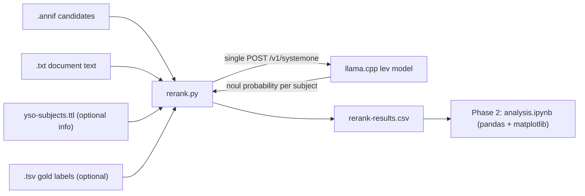

# Jev-like decision model reranking of Annif suggestions — Phase 1

Prototype to test whether a decision model (llama.cpp `/v1/systemone`,
System One / Jev API) can rerank Annif's automated subject-indexing
suggestions by confirming each candidate subject against the document text.

This document covers **Phase 1 only**: a plain Python script (`rerank.py`)
that exercises the API and stores raw per-subject decision-model results to
CSV. Phase 2 (a Jupyter notebook for analysis/visualization) reads that CSV
later and is out of scope for now.

## Data

Test sets live under `jev-test-sets/{fi,en}/`, one file-set per book keyed by
ISBN:

- `<isbn>.txt`  — document text (single-paragraph book description) → **state**
- `<isbn>.annif` — Annif suggestions, one per line:
  `<yso-uri>\t<label>\t<score>` (50 lines, sorted by score desc) → **candidates**
- `<isbn>.tsv`   — gold-standard YSO subjects: `<yso-uri>\t<label>` → **ground truth**
                   and also a **source of extra candidates** (see below)

Not every book has all three files, so the script only processes books that
have **both** `.txt` and `.annif`, and treats a missing `.tsv` as "no gold
labels" (in_gold=False for every row).

## Approach

For each book:
1. state = document text (`.txt`).
2. Build the candidate list:
   - **Annif suggestions** (top `--limit` from `.annif`), each tagged
     `source=annif`.
   - **Gold-extra subjects**: subjects from `.tsv` whose `yso_uri` does NOT
     appear in the Annif list, each tagged `source=gold_extra`.
     (These let Phase 2 measure how the decision model scores correct
     subjects that the base algorithm failed to suggest.)
3. One **noul** (yes/no) question per candidate (`--question-style` picks
   the phrasing; `sharp` is the default and the better of the two). An
   optional `--state-prefix` (indexing-policy instructions) is prepended
   to the state.
4. All questions are batched into a **single** `/v1/systemone` POST
   (the model reads the state once and answers all questions).
5. The returned `noul` probability per question becomes the rerank signal.

Phase 2 compares the decision model's yes-probability against Annif's
original score for `annif`-source rows (reranking quality), and examines
`noul_score` for `gold_extra` rows (how well the model identifies correct
subjects that were never in the base list).

## System One request / response

Request (`POST {base-url}/v1/systemone`):
```json
{
  "model": "ggml-org/lev-GGUF",
  "state": "<document text>",
  "questions": {
    "0":   {"type": "noul", "instructions": "This document is about spies."},
    "1":   {"type": "noul", "instructions": "This document is about espionage."},
    ...
    "50":  {"type": "noul", "instructions": "This document is about history."}
  }
}
```
Response:
```json
{
  "answers": {
    "0":  {"type": "noul", "noul": 0.91},
    "1":  {"type": "noul", "noul": 0.38},
    "50": {"type": "noul", "noul": 0.67}
  }
}
```
Question keys are arbitrary unique IDs; we use a sequential 0-based index
across all candidates (Annif suggestions first, then gold-extra subjects).

## Data flow



## CSV output schema

One row per (book, subject). Written with a header on first run.

| column        | meaning                                                        |
|---------------|----------------------------------------------------------------|
| `isbn`        | book identifier (file stem)                                    |
| `lang`        | language tag (from `--lang`, e.g. `en`)                        |
| `yso_uri`     | YSO concept URI                                                |
| `label`       | subject label used in the question                             |
| `source`      | `annif` (from the suggestion list) or `gold_extra` (added from `.tsv` because it was missing from Annif) |
| `annif_score` | Annif's original score (blank for `gold_extra` rows)           |
| `annif_rank`  | 0-based Annif position (blank for `gold_extra` rows)           |
| `noul_score`  | decision model P(yes); blank if the request failed             |
| `in_gold`     | `true`/`false` — whether the subject is in the `.tsv` gold set |
| `instruction` | exact question string sent (useful to reproduce/debug)         |
| `model`       | model id used for this run                                     |

## CLI / config

| arg              | default                 | env override    |
|------------------|-------------------------|-----------------|
| `--dataset-dir`  | `jev-test-sets/en`      | —               |
| `--lang`         | `en`                    | —               |
| `--base-url`     | `http://localhost:8080` | `ANNIF_JEV_URL` |
| `--model`        | `ggml-org/lev-GGUF`     | `ANNIF_JEV_MODEL`|
| `--output`       | `-` (stdout)            | —               |
| `--question-style` | `sharp`               | —               |
| `--state-rules`  | `false`               | —               |
| `--state-prefix` | `` (empty)              | —               |
| `--limit`        | `50`                    | —               |
| `--retries`      | `2`                     | —               |
| `--dry-run`      | `false`                 | —               |
| `--max-docs`     | `0` (all)               | —               |

`--state-rules` prepends the built-in indexing-rules prefix (the
"do not assign the document's own format or genre as a subject" rule) to
the document state for every question; `--state-prefix` takes custom text
and overrides the built-in rule. The rules improve the result on the en
set; see the README Findings.

`--dry-run` processes the first book fully (parse candidates, build the
request payload) and prints the JSON body to stdout, then exits. No HTTP
request is made and no CSV is written. Useful for debugging the question
format and payload shape before hitting the live API.

`--output -` (the default) writes the CSV to **stdout**, so the result can be
piped directly (`… | column -t -s,` or into pandas/`pandas.read_csv`). All
progress/diagnostics go to **stderr**, keeping stdout clean for the CSV. Pass
a filename (e.g. `--output rerank-results.csv`) to write to a file instead.

## Dependencies

`requests` only (plus `pandas`/`matplotlib` for the Phase 2 scripts).
No Annif import — this is a standalone prototype, not an Annif backend.
Python 3.10+.

## Phase 2 (later, out of scope)

`analysis.ipynb` reads `rerank-results.csv` (+ the `.tsv` gold files) with
pandas and uses matplotlib to:
- compute precision/recall/F1 and NDCG for the Annif ranking vs. the
  noul-score ranking (and blended variants) using `source=annif` rows,
- examine `noul_score` distribution for `gold_extra` rows — how well the
  model identifies correct subjects the base algorithm missed,
- scatter `annif_score` vs `noul_score` and rank-correlation (Spearman/Kendall),
- per-document waterfall of where gold subjects moved up/down,
- sensitivity to a confidence cutoff (act on `noul_score > t`, leave the rest).
